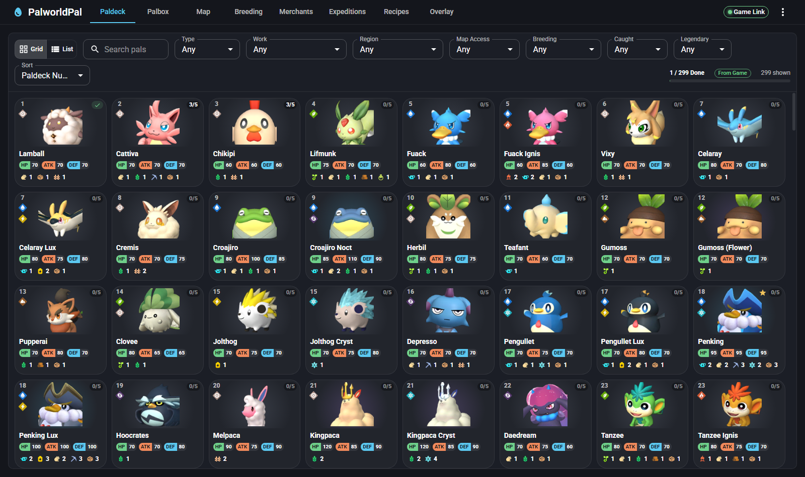
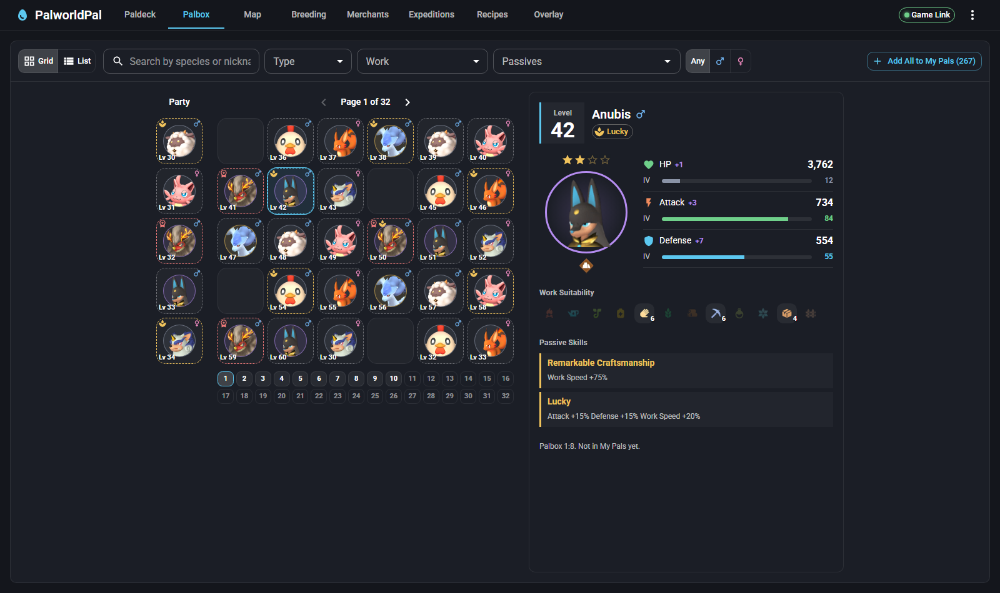
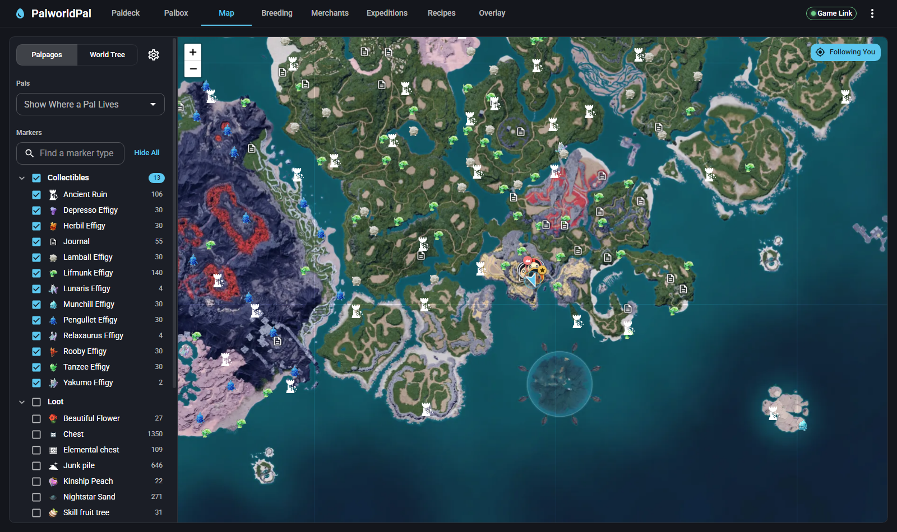
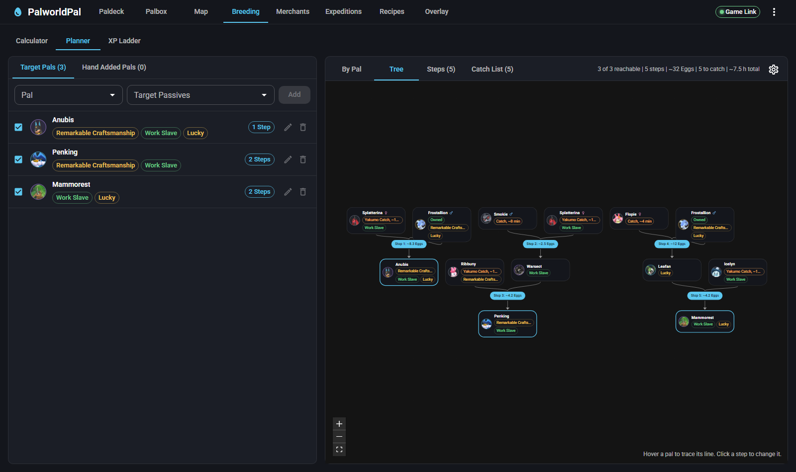
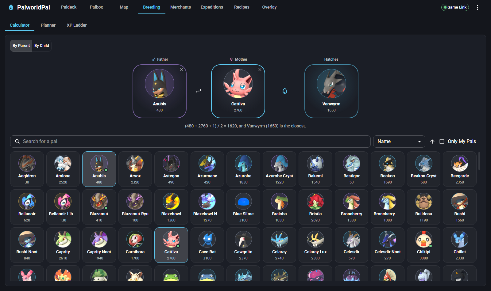
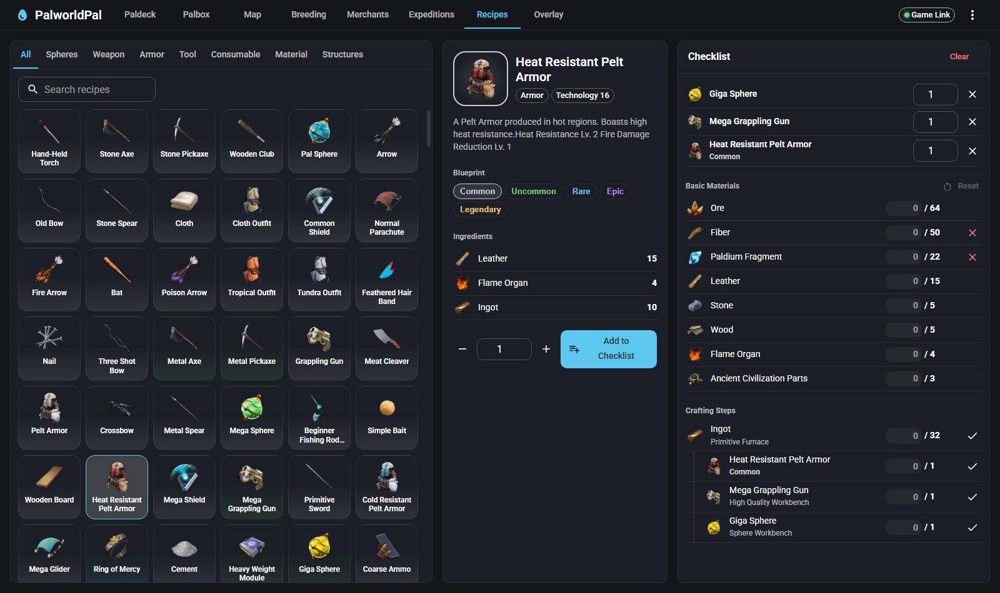
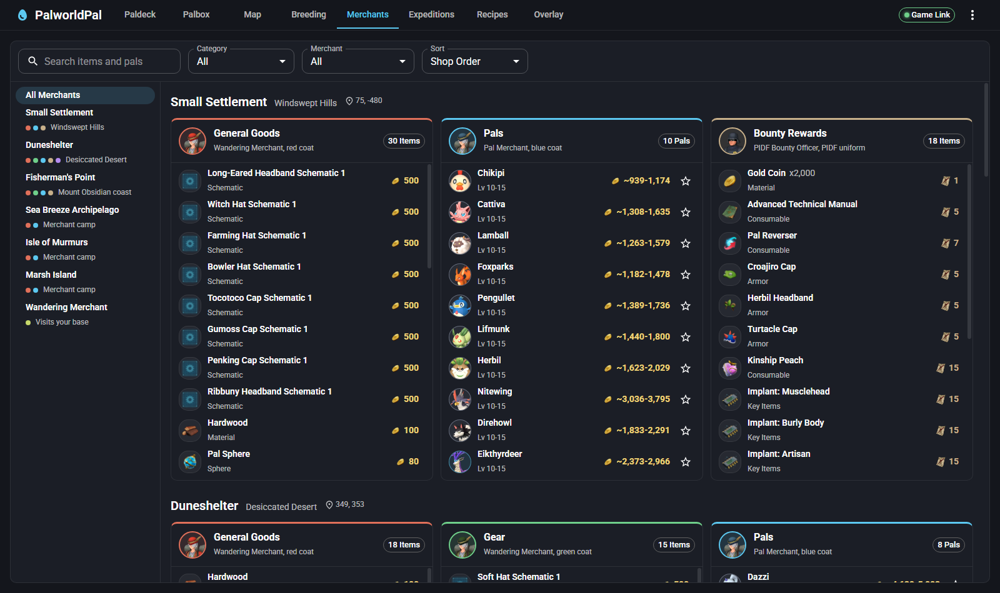

<p align="center">
  
</p>

<h1 align="center">PalworldPal</h1>

<p align="center">
  A local-first desktop companion and reference database for Palworld.
</p>

<p align="center">
  <a href="../../releases"><b>Download the Latest Release</b></a>
</p>



## Features

- **Breeding Planner** - add the pals you want with the passives you want, and it plans every
  breeding step from the pals you already have, with expected eggs, catches and time.
  Intermediate pals are shared between targets, and you can swap any step for another pairing.
- **Breeding Calculator** - pick two parents to see what hatches, or pick a child to see every
  pair that makes it.
- **XP Ladder** - breeding rounds that fill out your Paldeck catch counts from pals you already
  caught.
- **Paldeck** - every pal in a grid or list, with types, work suitability, stats and where it
  lives. Filter by type, work, region, breeding line and more; right-click a pal to target it,
  see its breeding combinations or find it on the map.
- **Palbox** - your party and all 32 Palbox pages as they are in game, with search by species,
  nickname, type, work and passives, and a detail panel with level, IVs and passives.
- **Map** - the full Palpagos and World Tree maps with markers for effigies, journals, chests,
  alpha pals, dungeons, ores, eggs, fast travel and more. Shows where any pal lives by day and night, follows you live
  while you play, shows nearby wild pals (alphas and lucky pals called out), and greys out
  effigies and journals you've already collected.
- **Merchants** - what every stationed merchant sells, and where they stand.
- **Expeditions** - rewards per run or per hour, with your strongest Palbox team picked
  automatically.
- **Recipes** - every crafting and build recipe. Add things to a checklist to get the total
  basic materials and every crafting step in order.
- **Overlay** - a compass and minimap drawn over the game (Ctrl+Shift+O), using the same markers
  as the Map tab.

The Palbox, live map, wild pals, collected effigies and catch counts come from the optional
**Game Link** mod below. Everything else works without it.

## Screenshots

| | |
| --- | --- |
|  |  |
| **Palbox** | **Map** |
|  |  |
| **Breeding Planner** | **Breeding Calculator** |
|  |  |
| **Recipes** | **Merchants** |

## Install

1. Download `PalworldPal-<version>-portable.exe` from the newest entry in
   [Releases](../../releases).
2. Run it. There is no installer; the exe is the whole app. Windows SmartScreen may warn about an
   unrecognized app because the exe isn't code-signed: click **More info**, then **Run anyway**.

Your lists and settings are saved in `%APPDATA%\palbreeder`, so a newer exe picks up where the
old one left off.

## Game Link (optional)

Game Link is a small client-side UE4SS mod that shares your position, Paldeck catches, party and
Palbox, nearby wild pals and collected effigies with the app. It's client-side only, so it works
on dedicated servers that don't have it. Don't use it on official servers.

1. Install UE4SS for Palworld: subscribe to **UE4SS Experimental (Palworld)** on the Steam
   Workshop and turn it on in Palworld under Options, Mod Management, then start the game once.
   (Or unzip [Okaetsu's UE4SS-Palworld.zip](https://github.com/Okaetsu/RE-UE4SS/releases) into
   `Palworld\Pal\Binaries\Win64`.)
2. In the app, open **Game Link** (top right) and click **Install**. It finds Palworld in your
   Steam libraries (or lets you choose the folder) and copies the mod into UE4SS's `Mods` folder.
3. Start Palworld and load into a world. The Game Link chip turns green.

The Palbox only fills in pages you've opened in game this session; the app keeps the rest from
earlier sessions and dims them as out of date.

If nothing arrives, check `ue4ss\UE4SS.log` for lines starting with `[PalBreederBridge]`. The mod
writes its files to `%APPDATA%\palbreeder\bridge\`.

## Building from source

Requires a current Node.js LTS.

```
npm install
npm run dev
```

- `npm run dev:web` serves the UI in a browser without the Electron window; add `?fakebridge`
  to the URL to simulate a player walking around with a synced Palbox.
- `npm test` runs the tests.
- `npm run package` builds the portable exe into `release/<version>/`.
- `npm run data`, `npm run recipes`, `npm run expeditions` and `npm run icons` regenerate the game
  data and icons after a game update (see [Data sources](#data-sources)).

The mod lives in `mod/PalBreederBridge` (Lua, UE4SS).

## How plans are chosen

- Each target pal is solved as a search over breeding pairs up to the generation limit (1-5).
  Pals you own cost nothing, catches cost a rough find-and-catch time based on rarity and spawn
  level (more for World Tree pals), and each breeding step costs its expected eggs times the
  minutes-per-egg setting.
- Passive odds use the game's weights: 1-4 passives inherited from the parents' combined pool
  (40/30/20/10%), then 0-3 random ones (40/30/20/10%). With "Only wanted passives" on, a step
  that carries wanted passives aims for an egg with those and nothing else.
- Gender only costs extra where a pairing forces it: a bred pal paired with an owned one must be
  the opposite gender, and two bred parents need one of them re-hatched until they differ. A
  catch always takes whichever gender its partner needs.
- Every target pal is planned on its own first, then re-planned with what the others make
  treated as free, so shared intermediates win. Paused targets still take part in that, but
  their own steps stay out of the steps and catch list.
- Owned Yakumo (with condensation stars set) add "catch with Yakumo summoned" options: each of
  its copyable passives lands on a capture with 15/18/21/24/30% chance by stars, in slot order,
  into free slots.
- With the Surgery Table on, passives you can implant aren't bred for; the final pal keeps free
  slots for them.
- The swap button on a bred pal lists every pair that makes it. Choosing one pins it for that
  exact pal (species plus wanted passives) everywhere it appears.

## Data sources

- Pal, breeding and passive data comes from the game-extracted database in
  [PalCalc](https://github.com/tylercamp/palcalc) (MIT), as do the pal and work icons.
- Map tiles, markers, spawn areas, recipes, merchant stock and item icons come from
  [paldb.cc](https://paldb.cc); merchant stock was cross-checked against
  [palworld.tools](https://palworld.tools).
- Expedition rewards come from [palpedia.com](https://palpedia.com/expeditions).

Thanks to all of them; this app wouldn't exist without their work.

## License

[MIT](LICENSE). Game data and images aren't covered by it; see the disclaimer below.

## Disclaimer

PalworldPal is a fan-made tool and isn't affiliated with or endorsed by Pocketpair. Palworld and
all of its names, images and game data are the property of Pocketpair, Inc.
